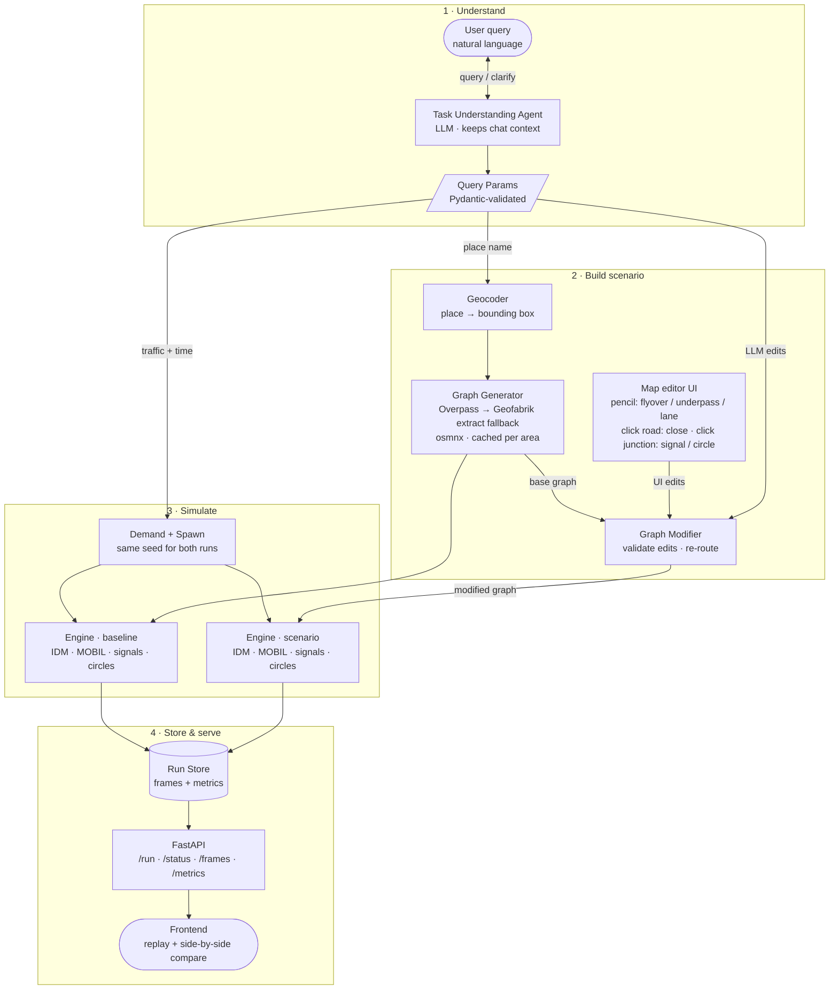

# Vehicle Flow Simulator

Describe a place and a change in plain language, for example *"close one lane of Hosur Road at
Silk Board at 9 am, heavy traffic"*. The app simulates the area twice with the same random
seed: once as it is (baseline) and once with your change (scenario). It then shows both
replays side by side, with the metrics compared.

Live: <https://vfsim-994012978460.asia-south1.run.app>



## What it does

- **Chat agent**: an LLM (self-hosted Ollama, `qwen3:8b`) turns the request into validated
  parameters: place, traffic level, time of day and road closures.
  - It never produces coordinates. Places are geocoded with Nominatim.
  - If the LLM is unreachable, a keyword parser takes over.
- **Real road networks**: roads come from OpenStreetMap through osmnx.
  - If the public Overpass servers fail, the area is cut from roads-only Geofabrik extracts
    covering all of India.
  - Graphs are cached per area.
  - The simulated area is capped at 2 km².
- **Agent-based engine**: every vehicle (bike, auto, car, truck) is its own agent, with its
  own route, maximum speed and size. Agents are stored as numpy arrays.
  - Vehicles follow the car ahead with IDM and change lanes with MOBIL.
  - Capacity emerges from the lane count. It is not hard-coded.
  - Flyovers and underpasses are grade-separated.
  - Every junction where turn paths cross gets a fixed-time signal.
- **Map editor**:
  - Close roads, single directions or single lanes.
  - Draw a flyover, an underpass or an extra lane between two points.
  - Turn any junction into a fixed-time signal or a roundabout.
- **Metrics**: travel time, throughput, queue length, delay per junction and a speed heatmap,
  each compared between baseline and scenario. The result also reports, for each edit, how
  vehicles used it.

## Architecture

Language in, two seeded runs out, compared side by side (diagram at the top).

### Flow in words

1. **Understand**: the user query goes to the Task Understanding Agent (LLM), which asks clarifying questions when needed and outputs Pydantic-validated Query Params.
2. **Build scenario**: the place name goes to the Geocoder, which gives a bounding box, then the Graph Generator builds the base graph (cached per area). Roads come from the public Overpass API (time-limited; servers that fail are skipped); when Overpass fails, the area is cut with `osmium` from a roads-only Geofabrik extract (all of India: six zone files plus a whole-India file for areas on zone borders) kept in a Cloud Storage bucket mounted on Cloud Run. Both sources give the same OSM tags, and osmnx turns the OSM XML into the graph. Edits from the LLM (closures) or the map editor UI go to the Graph Modifier (`scenario/builder.py`), which validates them and re-routes, producing the modified graph. The map editor adds a flyover, an underpass or an extra lane between two clicked points, and turns a junction into a fixed-time signal or a circle. A click in the middle of a road splits the road there; the same split is applied to the baseline graph, so road ids are identical in both runs. The simulated area is capped at 2 km².
3. **Simulate**: traffic level and time of day set Demand + Spawn. Two engine runs use the same seed: baseline on the base graph, scenario on the modified graph. Every junction where turn paths cross has a fixed-time signal by default (ramp merges and diverges do not); one stop duration sets the red time of every approach, with equal greens. The result lists, per edit, what the vehicles did with it (`info.edit_usage`).
4. **Store & serve**: frames and metrics go to the Run Store, which is served through FastAPI (`/run`, `/status`, `/frames`, `/metrics`). The frontend replays both runs side by side. Runs not written to for 24 h are deleted at start-up and then daily.

## Repository layout

| Path | Contents |
|---|---|
| `backend/app/api` | FastAPI routes and request/response schemas |
| `backend/app/llm` | Chat agent and the swappable LLM provider |
| `backend/app/geo` | Geocoder, Overpass client, offline extracts, graph builder |
| `backend/app/scenario` | Closures and map-editor edits applied to the graph |
| `backend/app/sim` | Simulation engine: demand, routing, IDM, MOBIL, junctions, signals, metrics |
| `backend/app/runs` | Per-session worker processes, run store, replay export |
| `backend/seed` | Bundled Silk Board graph, so the app works with no network access |
| `backend/tests` | pytest suite (runs offline on synthetic grids) |
| `frontend/` | Svelte 5 + Vite UI, with Leaflet for the map and uPlot for the charts ([frontend/README.md](frontend/README.md)) |
| `deploy/gcp` | Cloud Run deploy scripts |
| `.github/workflows` | CI/CD |

## Run locally

You need Python 3.12 with [uv](https://docs.astral.sh/uv/), and Node 24.

```bash
cp .env.example .env

# API on :8000
cd backend && uv sync && uv run uvicorn app.main:app --reload --port 8000

# UI on http://localhost:5173 (proxies /api to :8000)
cd frontend && npm install && npm run dev
```

The chat works without an LLM by using the keyword parser. For the full agent, run Ollama
locally (`ollama serve`, then `ollama pull qwen3:8b`); `.env.example` already points to it.

Docker alternative (serves the API and the built UI on :8000):

```bash
docker compose up --build
```

### Command-line runs

The engine also runs without the API or the LLM:

```bash
cd backend
uv run python -m app.sim.cli --place "Silk Board Junction, Bengaluru" \
    --traffic high --time 09:00 --duration 1800 --close-lanes "Hosur:0"
```

## Tests

```bash
cd backend
uv run ruff check app tests
uv run pytest
```

The tests need no network: they use a temporary data folder, a cached geocode and synthetic
road grids.

## Configuration

Settings are read from `.env` (see [.env.example](.env.example)). The ones most often changed:

| Variable | Default | Meaning |
|---|---|---|
| `LLM_MODEL` | `qwen3:8b` | Ollama model for the chat agent |
| `OLLAMA_HOST` | `http://localhost:11434` | Ollama server |
| `OLLAMA_AUTH` | `none` | `none`, `gcp` (Google ID token, Cloud Run) or `key` (Ollama Cloud) |
| `SIM_SEED` | `42` | Random seed shared by baseline and scenario |
| `MAX_WORKERS` | `8` | Concurrent simulation worker processes (one per browser session) |
| `DATA_DIR` | `data/` | Graph cache, geocode cache and run results |
| `RUN_TTL_H` | `24` | Runs with no writes for this many hours are deleted |
| `OSM_EXTRACTS_DIR` | unset | Folder of roads-only `.osm.pbf` extracts (the Overpass fallback) |

Never commit `.env` or `data/`.

## Deployment

The app runs as one Google Cloud Run service. FastAPI serves both the API and the built
frontend from the root [Dockerfile](Dockerfile).

**Continuous deployment**: [.github/workflows/ci-cd.yml](.github/workflows/ci-cd.yml) runs the
backend tests and the frontend build on every push and pull request. A push to `main` that
passes is then deployed. GitHub authenticates to Google Cloud through Workload Identity
Federation, so there is no key file.

The one-time setup scripts, in this order:

```bash
PROJECT_ID=<project> ./deploy/gcp/deploy-ollama.sh     # private GPU service for the chat LLM
PROJECT_ID=<project> ./deploy/gcp/build-extracts.sh    # offline OSM extracts bucket (rerun monthly)
PROJECT_ID=<project> ./deploy/gcp/deploy.sh            # first deploy of the app
PROJECT_ID=<project> REPO=<owner/name> ./deploy/gcp/setup-cicd.sh   # GitHub -> GCP trust
```

Things to know about the service:

- It runs a single, always-on instance, because the run store sits on the instance's local
  disk.
- Run results are lost when the instance restarts.

## Further reading

- [architecture.md](architecture.md): the architecture section above, as a stand-alone file.
- [docs/bug-report.md](docs/bug-report.md): known bugs and their status.
- [CLAUDE.md](CLAUDE.md): the feature specification and coding rules.
