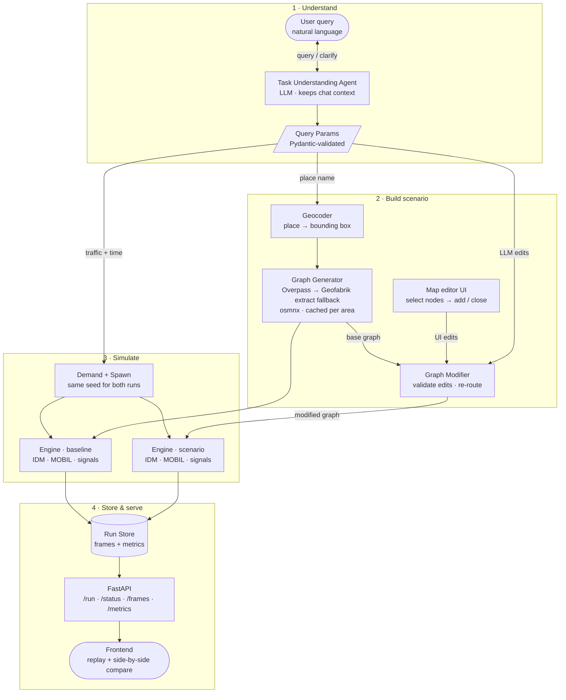

# Vehicle Flow Simulator — Architecture

Language in, two seeded runs out, compared side by side.

## Flow in words

1. **Understand**: the user query goes to the Task Understanding Agent (LLM), which asks clarifying questions when needed and outputs Pydantic-validated Query Params.
2. **Build scenario**: the place name goes to the Geocoder, which gives a bounding box, then the Graph Generator builds the base graph (cached per area). Roads come from the public Overpass API (time-limited; servers that fail are skipped); when Overpass fails, the area is cut with `osmium` from a roads-only Geofabrik extract (all of India: six zone files plus a whole-India file for areas on zone borders) kept in a Cloud Storage bucket mounted on Cloud Run. Both sources give the same OSM tags, and osmnx turns the OSM XML into the graph. Edits from the LLM or the map editor UI go to the Graph Modifier, which validates them and re-routes, producing the modified graph.
3. **Simulate**: traffic level and time of day set Demand + Spawn. Two engine runs use the same seed: baseline on the base graph, scenario on the modified graph.
4. **Store & serve**: frames and metrics go to the Run Store, which is served through FastAPI (`/run`, `/status`, `/frames`, `/metrics`). The frontend replays both runs side by side.
